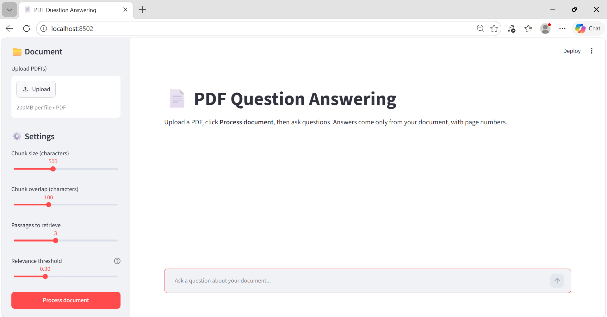
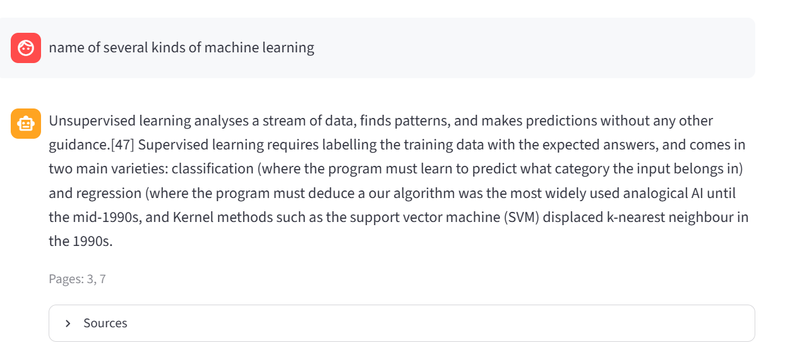
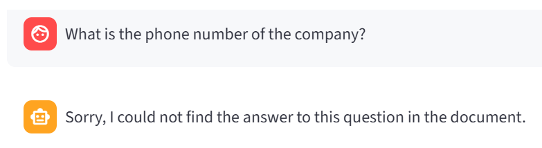

# 📄 PDF Question Answering System (RAG)

> 🎥 **Demo video:** https://drive.google.com/file/d/1iEu79KhEgA5AX0W1-cfzxO1Clt0AgxJ3/view?usp=drive_link (also available in the [`demo/`](demo/) folder)

A web app where you upload a PDF, ask questions in plain language, and get a short answer based **only on that PDF**, together with the page numbers where the answer was found. If the answer is not in the document, the app says so instead of guessing.

## The problem
Language models can invent answers. This project uses **Retrieval-Augmented Generation (RAG)**: it first searches the document for the most relevant text and then asks a small language model to answer using only that text, so every answer can be checked against its source pages.

## Key features
- Upload one or several PDFs with a visible progress indicator
- Page-aware chunking (default: 500 characters, 100 overlap), every chunk remembers its file and page
- Semantic search with `all-MiniLM-L6-v2` embeddings and a FAISS index (cosine similarity)
- Answer generation with `flan-t5-base`, using only the retrieved text
- **Sources** section under every answer (page numbers and matching text)
- "Not found" message when nothing relevant is found (relevance threshold)
- Friendly messages for empty input, wrong/scanned PDFs and missing document
- Chat-style interface, sidebar settings (chunk size, overlap, number of passages, threshold)
- Clear chat and download chat as a text file

## How it works
```
PDF -> extract text per page -> chunk (with page numbers) -> embed (MiniLM)
    -> FAISS index -> question embedding -> top-k similar chunks
    -> threshold check -> flan-t5-base writes the answer -> answer + sources
```

## Tools and models
| Part | Tool |
|---|---|
| Interface | [Streamlit](https://streamlit.io/) |
| PDF reading | [pypdf](https://pypdf.readthedocs.io/) |
| Embeddings | [sentence-transformers/all-MiniLM-L6-v2](https://huggingface.co/sentence-transformers/all-MiniLM-L6-v2) |
| Vector search | [FAISS](https://github.com/facebookresearch/faiss) (`faiss-cpu`, flat inner-product index) |
| Answer generation | [google/flan-t5-base](https://huggingface.co/google/flan-t5-base) |

**Data:** the PDFs in `sample_docs/` were created by me for testing (synthetic text, no license restrictions):
`library_policy_sample.pdf` (4 pages), `long_report_sample.pdf` (55 pages), `tables_sample.pdf` (3 pages, answers inside tables).

## Project structure
| File | Purpose |
|------|---------|
| `app.py` | Streamlit interface |
| `loader.py` | PDF reading and chunking |
| `vector_store.py` | Embeddings and FAISS index |
| `generator.py` | Prompt building and answer generation |
| `test_retrieval.py` | Retrieval test without any interface |
| `sample_docs/` | Test PDFs |
| `demo/` | Demo video and screenshots |

## Installation
Tested with **Python 3.11** on Windows (very new Python versions such as 3.14 can fail to load PyTorch).

```bash
python -m venv venv
venv\Scripts\activate          # Windows   (Linux/Mac: source venv/bin/activate)
pip install -r requirements.txt
streamlit run app.py
```
The first run downloads the models (a few minutes, needs a few GB of free disk space). The app opens at `http://localhost:8501`.

To run the retrieval test: `python test_retrieval.py`

## Screenshots



## Results

### 1. Retrieval test (`test_retrieval.py`)
13 questions on 3 PDFs. A question counts as a hit if a chunk from the correct page is in the top 3 results.

**Top-3 hit rate: 13/13 (100%)** with chunk size 500 and overlap 100.

| # | PDF | Question | Expected page | Result |
|---|---|---|---|---|
| 1 | library_policy_sample.pdf | What are the library opening hours on weekdays? | 1 | HIT (rank 2) |
| 2 | library_policy_sample.pdf | How many books can an undergraduate student borrow? | 2 | HIT (rank 1) |
| 3 | library_policy_sample.pdf | What is the late return fine per day? | 3 | HIT (rank 1) |
| 4 | library_policy_sample.pdf | How many group study rooms are there? | 4 | HIT (rank 1) |
| 5 | long_report_sample.pdf | How many million litres of water does the treatment plant process per day? | 7 | HIT (rank 1) |
| 6 | long_report_sample.pdf | How long is the Eastern Bypass road? | 18 | HIT (rank 1) |
| 7 | long_report_sample.pdf | How many public schools does the city operate? | 29 | HIT (rank 1) |
| 8 | long_report_sample.pdf | How many tonnes of solid waste are collected daily? | 41 | HIT (rank 1) |
| 9 | long_report_sample.pdf | What is the total approved budget for fiscal year 2026? | 52 | HIT (rank 1) |
| 10 | tables_sample.pdf | What is the price of the Mechanical Keyboard? | 1 | HIT (rank 1) |
| 11 | tables_sample.pdf | How many units of the USB-C Hub are in stock? | 1 | HIT (rank 1) |
| 12 | tables_sample.pdf | What grade did Usman Ali get? | 2 | HIT (rank 1) |
| 13 | tables_sample.pdf | Which region had the highest total sales? | 3 | HIT (rank 1) |

### Similarity Threshold

- **Chunk size:** 500
- **Chunk overlap:** 100
- **Top-3 hit rate:** 13/13 (100%)
- **Recommended similarity threshold:** 0.55

A similarity threshold of `0.55` is a conservative starting point for filtering low-confidence retrieval results. In testing, the highest similarity score for a question whose answer was not found in the PDF was `0.52`, while the lowest best-match score for a relevant result was `0.40`.

### 2. End-to-end test (full app, library_policy_sample.pdf, 10 questions: 7 answerable + 3 not answerable)

| # | Question | In PDF? | App answer | Correct? |
|---|---|---|---|---|
| 1 | What are the library opening hours on weekdays? | Yes | 8:00 AM to 8:00 PM | Yes |
| 2 | How many books can a postgraduate student borrow? | Yes | up to 8 books | Yes |
| 3 | What is the maximum fine for one book? | Yes | Rs. 500 | Yes |
| 4 | How many online research databases are available? | Yes | 12 | Yes |
| 5 | Where is the library located? | Yes | in the Science Block, second floor | Yes |
| 6 | What must a student leave at the desk when using a library laptop? | Yes | ID card | Yes |
| 7 | Who decides the fine for a damaged book? | Yes | head librarian | Yes |
| 8 | Who is the vice chancellor of the university? | No | Sorry, I could not find the answer to this question in the document. | Yes |
| 9 | How much is the tuition fee per semester? | No | Sorry, I could not find the answer to this question in the document. | Yes |
| 10 | Does the library have a cafeteria? | No | Sorry, I could not find the answer to this question in the document. | Yes |

**Result: 10/10 correct** (7/7 answerable questions answered correctly, 3/3 unanswerable questions correctly refused).


### 3. Failure analysis
- **Comparing values in tables.** For "Which region had the highest total sales?" retrieval found the right page (page 3), but `flan-t5-base` answered "not found". The small model cannot compare several numbers in a table. So here the weak part is the generator, not the retrieval.
- **Copying table text.** When many short pages are retrieved together (for example 3 table pages), the model sometimes copied the context text instead of giving a short answer. Retrieving only 1 passage for such questions gave better results.

## Limitations
- `flan-t5-base` reads only about 512 tokens, so the prompt must stay short and long answers are not possible.
- Calculations and comparisons across several values (especially in tables) are unreliable.
- Scanned PDFs (images without text) are not supported; the app shows a message. OCR could be added.
- Table structure is lost during text extraction, so answers inside tables are harder to find.
- The relevance threshold is a trade-off: a high value may reject valid questions, a low value may answer questions that are not in the document.
- Tested mainly on my own synthetic PDFs; results on other documents may be lower.

## Future improvements
- A stronger open-source instruction model (for example Qwen2.5-1.5B-Instruct) for better answers
- Re-ranking with a cross-encoder after retrieval
- OCR for scanned PDFs and better table handling
- Hybrid search (keyword + vector) and a "Summarize document" button

## Author
**Muhammad Arsalan Zahid**: [LinkedIn](https://www.linkedin.com/in/muhammad-arsalan-zahid-aa255b330/)

*Built during the AI/ML Internship at Taviq AI Solutions.*
